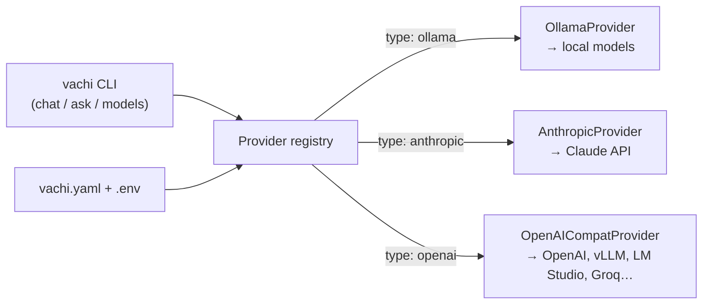

# Vachimodel

**Vachi** is a self-hosted, plug-and-play AI assistant. Model providers (hosted APIs or
models on your own machine) are plugins: you switch between them with one setting.
Data sources and tools become plugins in later phases. See [PROMPT.md](PROMPT.md) for the full plan.

## Status

| Phase | What | Status |
|---|---|---|
| 1 | Core + model providers + terminal chat | Done |
| 2 | API server + web chat UI | Next |
| 3–9 | Routing, data sources/RAG, tools/MCP, users, eval, production, own model | Planned |

## Quick start

Needs [uv](https://docs.astral.sh/uv/) (it installs Python 3.12 for the project automatically).

```bash
cd Vachimodel
make setup          # installs packages, creates vachi.yaml and .env from the examples
```

Then pick at least one model provider:

**Free, on your Mac (Ollama)**
```bash
brew install ollama          # or download the app from https://ollama.com
ollama serve                 # leave running in its own terminal (not needed if the app is open)
ollama pull llama3.2         # ~2 GB download, runs fine on a 16 GB Mac
```

**Hosted API (Anthropic or OpenAI):** put your key in `Vachimodel/.env`
(`ANTHROPIC_API_KEY=...` or `OPENAI_API_KEY=...`). `.env` is git-ignored.

Then:

```bash
make models                                   # list models from every provider
make chat                                     # chat with models.default from vachi.yaml
make chat MODEL=anthropic/claude-opus-5-5     # chat with a specific model
cd backend && uv run vachi --config ../vachi.yaml ask "Explain Docker volumes in 3 lines"
```

Inside `chat`: `/model provider/model` switches model and keeps the conversation,
`/clear` starts over, `/exit` quits, and Ctrl-C stops an answer mid-way.

## How it's built (Phase 1)



```
backend/src/vachi/
  core/messages.py     one internal message format (Message, ChatRequest, ChatChunk, Usage)
  core/interfaces.py   ModelProvider: the interface every provider plugin implements
  core/config.py       loads vachi.yaml, fills ${ENV_VAR} from the environment / .env
  core/registry.py     finds provider plugins (Python entry points) and builds them from config
  core/errors.py       human-readable errors (bad key, server down, model missing, rate limit)
  providers/           ollama.py, anthropic.py, openai_compat.py
  cli.py               the `vachi` command
backend/tests/         34 tests; all network calls are mocked, so no API keys or money needed
```

Design rules:
- The core never imports a specific provider. Providers are found through the
  `vachi.providers` entry point group in `pyproject.toml`, so a separate pip package can
  add a provider without touching Vachi's code.
- Model names are always `provider_id/model_name` and live in config, never in code.
- Secrets are only read from the environment or `.env`, and are substituted only when a
  provider is used. A missing OpenAI key doesn't stop you from using Ollama.
- Every provider error becomes a clear message, never a stack trace.

### Adding a provider

1. Write a class in `backend/src/vachi/providers/` that subclasses `ModelProvider`, sets
   `type_name` and a pydantic `Config`, and implements `list_models()` and `chat()`
   (an async generator yielding `ChatChunk`s and ending with one `type="done"` chunk).
2. Register it in `backend/pyproject.toml` under `[project.entry-points."vachi.providers"]`.
3. Add it to `vachi.yaml` with `type: <your type_name>`.

## Concepts used in Phase 1

- **Token:** the unit models read and write, roughly ¾ of an English word. Hindi usually
  takes more tokens per word. APIs charge per token.
- **Context window:** the most tokens a model can look at in one request (your whole
  conversation + its answer). `vachi models` shows it where the provider reports it.
- **System prompt:** instructions sent with every request that set the assistant's role and
  rules. Vachi's lives in `system_prompt` in `vachi.yaml`.
- **Temperature:** how random the answers are (0 = predictable, higher = more varied). Some
  models, including current Claude models, don't accept it; Vachi then just doesn't send it.
- **Streaming:** the answer is sent piece by piece as it's generated, so you see it appear
  instead of waiting for the whole thing.
- **Stateless APIs:** models don't remember anything between requests. Chat "memory" is
  just Vachi sending the whole conversation history every time.

## Development

```bash
make test     # run tests
make lint     # ruff lint + format check
make fmt      # auto-fix formatting
```
