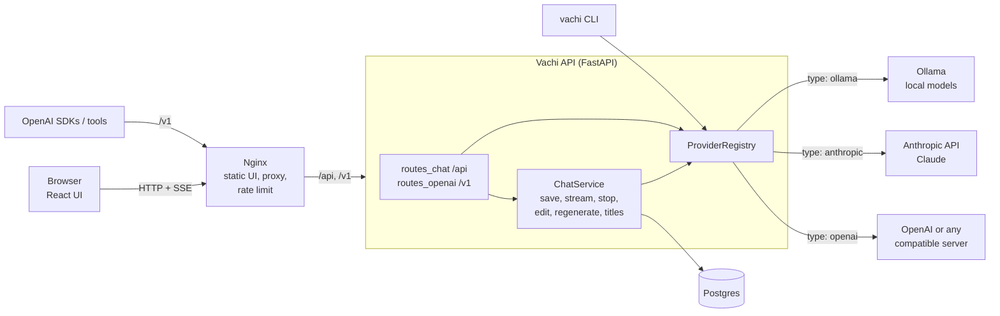
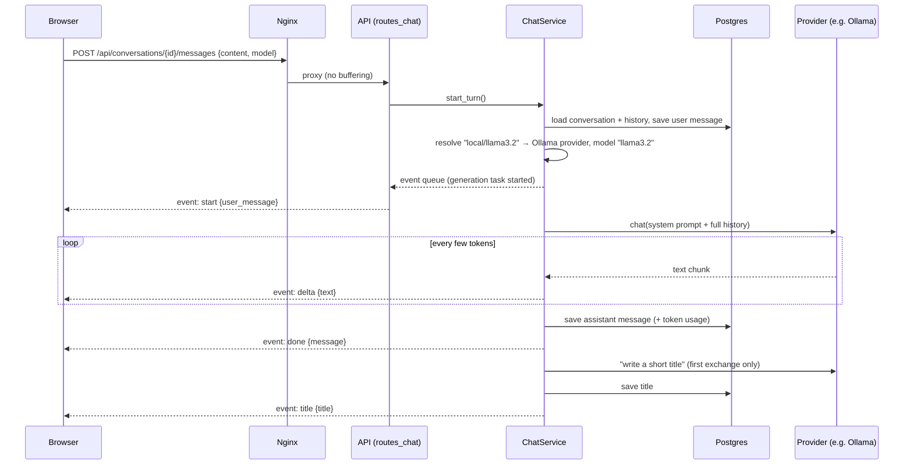

# Vachimodel — Vachi, a plug-and-play AI assistant

**Vachi** is a self-hosted chat assistant that looks and works like ChatGPT or Claude.
You choose the "brain" behind it: free open models running on your own machine (through
Ollama), or hosted models from Anthropic (Claude), OpenAI, or any OpenAI-compatible server.
Switching is one setting, or one click in the UI.

This README has two halves:

- **Part A: the Vachi project.** What it does, how to run it, how it's built, and its API.
- **Part B: how large language models work.** The maths and logic behind models like Claude
  and ChatGPT: tokens, embeddings, attention, training, fine-tuning and sampling, with
  worked examples.

> **What this repo is, and isn't.** The trained weights and training code of Claude and
> ChatGPT are private to Anthropic and OpenAI. Nobody outside those companies can put
> "Claude's code" in a repo. Vachi is the application around a model: the chat app, API,
> storage, streaming and deployment. It can *use* Claude (through Anthropic's API), and it can
> run open-weight models you download. Part B explains how all of these models work inside,
> based on published research. The full plan for Vachi, including fine-tuning your own model
> (Phase 9), is in [PROMPT.md](PROMPT.md).

## Contents

**Part A: the Vachi project**
1. [Status](#1-status)
2. [Quick start with Docker](#2-quick-start-with-docker)
3. [Running without Docker (development)](#3-running-without-docker-development)
4. [Using Vachi from other tools (OpenAI-compatible API)](#4-using-vachi-from-other-tools-openai-compatible-api)
5. [Architecture](#5-architecture)
6. [What happens when you send a message](#6-what-happens-when-you-send-a-message)
7. [API reference](#7-api-reference)
8. [Configuration reference](#8-configuration-reference)
9. [Adding a new model provider](#9-adding-a-new-model-provider)
10. [Testing and code quality](#10-testing-and-code-quality)
11. [Troubleshooting](#11-troubleshooting)

**Part B: how LLMs work**

12. [The one idea: predict the next token](#12-the-one-idea-predict-the-next-token)
13. [Tokenization](#13-tokenization)
14. [Embeddings and positions](#14-embeddings-and-positions)
15. [The transformer block](#15-the-transformer-block)
16. [Self-attention, step by step](#16-self-attention-step-by-step)
17. [The feed-forward network](#17-the-feed-forward-network)
18. [From the last layer to a probability for every token](#18-from-the-last-layer-to-a-probability-for-every-token)
19. [Counting parameters](#19-counting-parameters)
20. [Pre-training: how the model learns](#20-pre-training-how-the-model-learns)
21. [Why Claude-scale models cost so much](#21-why-claude-scale-models-cost-so-much)
22. [Post-training: from text predictor to assistant](#22-post-training-from-text-predictor-to-assistant)
23. [Generating text: decoding and sampling](#23-generating-text-decoding-and-sampling)
24. [Inference performance: KV cache, memory, quantization](#24-inference-performance-kv-cache-memory-quantization)
25. [Context windows and why chats are "stateless"](#25-context-windows-and-why-chats-are-stateless)
26. [Fine-tuning cheaply with LoRA](#26-fine-tuning-cheaply-with-lora)
27. [Retrieval (RAG): giving a model your documents](#27-retrieval-rag-giving-a-model-your-documents)
28. [Measuring quality](#28-measuring-quality)
29. [Vachi vs Claude/ChatGPT: an honest comparison](#29-vachi-vs-claudechatgpt-an-honest-comparison)
30. [Glossary](#30-glossary)
31. [Interview summary](#31-interview-summary)

---

# Part A — The Vachi project

## 1. Status

| Phase | What | Status |
|---|---|---|
| 1 | Core plugin system, 3 model providers, terminal chat (`vachi chat`) | ✅ Done |
| 2 | Web API with Postgres, OpenAI-compatible API, React chat UI, Docker Compose + Nginx | ✅ Done |
| 3 | More providers, automatic fallback, usage and cost tracking | Next |
| 4 | Data sources and RAG with citations | Planned |
| 5 | Tools, agents, MCP | Planned |
| 6 | Assistants, memory, users and permissions | Planned |
| 7 | Evaluation and safety | Planned |
| 8 | Production: HTTPS, monitoring, backups, CI/CD | Planned |
| 9 | Fine-tune your own model and plug it in | Planned |

**Chat features today:** answers stream as they're written; Markdown with highlighted code
and a copy button; chat history with search, rename, delete and export (Markdown/JSON);
edit an earlier message; regenerate an answer; stop mid-answer (the partial answer is kept);
switch model mid-conversation; automatic chat titles; temperature and length settings;
light/dark theme; phone layout; English, Hindi and Hinglish.

## 2. Quick start with Docker

Needs Docker, [uv](https://docs.astral.sh/uv/) and Node.js 20+ (uv and Node are only for `make setup`).

```bash
cd Vachimodel
make setup      # installs packages; creates vachi.yaml, and .env with a random database password
make up         # builds and starts everything
```

Open **http://localhost:8100**. The first start downloads the default local model
(`llama3.2`, about 2 GB), which can take a few minutes. Watch it with `make logs`.

To use Claude or OpenAI models too, add your key to `Vachimodel/.env` and restart with `make up`:

```bash
ANTHROPIC_API_KEY=sk-ant-...
OPENAI_API_KEY=sk-...
```

`.env` and `vachi.yaml` are git-ignored, so keys never reach GitHub.

**What runs:**

| Container | Image | Job |
|---|---|---|
| `web` | `nginx:1.30.5-alpine` + the built React UI | Serves the UI on port 8100, proxies `/api` and `/v1` to the API, rate limits |
| `api` | built from `backend/Dockerfile` (Python 3.12) | FastAPI app: chats, streaming, OpenAI-compatible API |
| `postgres` | `postgres:18.6-alpine` | Stores conversations and messages (volume `pg_data`) |
| `ollama` | `ollama/ollama:0.35.0` | Runs local models (volume `ollama_models`) |
| `ollama-pull` | `ollama/ollama:0.35.0` | One-off job that downloads `OLLAMA_MODEL`, then exits |

Every long-running container has a health check, a restart policy and CPU/memory limits.
The API runs as a non-root user. `make down` stops everything; data stays in the volumes
(`docker compose down -v` deletes it).

### Faster local models on a Mac

Docker on a Mac can't use the Apple GPU, so models in the `ollama` container run on the CPU.
For much faster answers, use the Ollama app installed directly on the Mac:

1. Install it: `brew install ollama` (or the app from ollama.com), then `ollama pull llama3.2`.
2. In `.env`, delete the `COMPOSE_PROFILES=ollama` line and add
   `OLLAMA_BASE_URL=http://host.docker.internal:11434`.
3. `make up`.

## 3. Running without Docker (development)

```bash
make serve      # API on http://127.0.0.1:8000, using a local SQLite file (backend/vachi.db)
make web        # UI with live reload on http://localhost:5173 (forwards /api to port 8000)
make chat       # or chat in the terminal
make chat MODEL=anthropic/claude-opus-5-5
```

Terminal chat commands: `/model provider/model` switches model and keeps the conversation,
`/clear` starts over, `/exit` quits, Ctrl-C stops an answer.

Other CLI commands: `vachi models` lists every provider's models, `vachi ask "question"`
prints one answer, `vachi serve` runs the API.

## 4. Using Vachi from other tools (OpenAI-compatible API)

Vachi speaks the same API as OpenAI, so any tool or SDK built for OpenAI can use it, with any
of Vachi's models. Model names are `provider_id/model_name`.

```bash
curl http://localhost:8100/v1/chat/completions \
  -H "Content-Type: application/json" \
  -d '{"model": "local/llama3.2", "messages": [{"role": "user", "content": "Hello!"}], "stream": true}'
```

```python
from openai import OpenAI

client = OpenAI(base_url="http://localhost:8100/v1", api_key="anything")
reply = client.chat.completions.create(
    model="anthropic/claude-opus-5-5",   # or local/llama3.2, openai/<model>, ...
    messages=[{"role": "user", "content": "Explain Docker networking in 3 lines"}],
)
print(reply.choices[0].message.content)
```

If you set `VACHI_API_KEY` in `.env`, clients must send it as `Authorization: Bearer <key>`.
The `/v1` API is stateless: it saves nothing. Chats in the UI use the `/api` routes instead.

## 5. Architecture



### Folder layout

```
Vachimodel/
  README.md, PROMPT.md        this file; the full 9-phase build plan
  vachi.example.yaml          example config (copied to vachi.yaml, which is git-ignored)
  .env.example                example secrets file (copied to .env, git-ignored)
  Makefile                    setup / test / lint / serve / web / chat / up / down / logs
  docker-compose.yml          web, api, postgres, ollama, ollama-pull
  nginx/                      Dockerfile (builds UI + Nginx), nginx.conf, security headers
  backend/                    Python package `vachi` (uv project)
    Dockerfile
    src/vachi/
      core/messages.py        Vachi's own message format: Message, ChatRequest, ChatChunk, Usage, ModelInfo
      core/interfaces.py      ModelProvider: the interface every provider plugin implements
      core/config.py          loads vachi.yaml; fills ${VAR} and ${VAR:-default} from env/.env
      core/registry.py        finds provider plugins via Python entry points; builds them from config
      core/errors.py          readable errors: bad key, server down, model missing, rate limit
      providers/              ollama.py, anthropic.py, openai_compat.py
      db/models.py            tables: conversations, messages
      db/session.py           database engine (Postgres in Docker, SQLite by default)
      chat/service.py         conversation logic, generation tasks, stop/edit/regenerate, titles
      api/app.py              FastAPI app, health/ready checks, error → HTTP status mapping
      api/routes_chat.py      /api routes for the UI (Server-Sent Events streaming)
      api/routes_openai.py    /v1 OpenAI-compatible routes
      cli.py                  `vachi` command: chat, ask, models, serve
    tests/                    51 tests; all network calls mocked, no API keys or money needed
  frontend/                   React + TypeScript + Vite
    src/api.ts                typed client for /api
    src/sse.ts                streaming (Server-Sent Events) parser, with tests
    src/App.tsx               app state: chats, streaming, edit, regenerate, stop
    src/components/           Sidebar, Header (model picker, settings, theme), Messages, Composer, Markdown
    src/index.css             light/dark theme tokens, phone layout, code highlighting colours
```

### Design decisions (and why)

| Decision | Why |
|---|---|
| **One internal message format**; each provider converts to/from its own API | The rest of the app never knows which provider it's talking to, so providers are swappable. |
| **Providers are Python entry points** (`vachi.providers` group in `pyproject.toml`) | The core never imports a specific provider. A separate pip package can add one. |
| **Model names are `provider_id/model_name`, always in config** | No hard-coded models; changing models never needs a code change. |
| **Secrets only from environment / `.env`, substituted lazily** | No secrets in git or images. A missing OpenAI key doesn't stop Ollama from working. |
| **Each answer runs in its own asyncio task that writes to a queue**; the HTTP response reads the queue | Generation and saving don't depend on the browser connection. Stop (or closing the tab) cancels the task, and the task still saves the partial answer. |
| **Server-Sent Events (SSE)** for streaming | Simple one-way streaming over normal HTTP; works through Nginx with `proxy_buffering off`. |
| **Read the first chunk before replying** on `/v1` | Provider errors (server down, bad key) become proper HTTP errors (503, 502, ...) instead of a broken stream. |
| **Errors mapped to status codes** in one table (`api/app.py`) | Consistent API behaviour: 400 bad request, 404 not found, 409 busy, 429 rate limited, 502/503 provider problems. |
| **Postgres in Docker, SQLite for development and tests** | Same SQLAlchemy code; tests run in under a second with no database server. |
| **Nginx serves the built UI and proxies the API** on one port | One origin means no CORS setup; Nginx adds rate limiting, security headers and caching of static files. |
| **Ollama behind a Compose profile** | On Linux servers it runs in Docker; on a Mac you can switch to the faster native app with one line in `.env`. |

## 6. What happens when you send a message



- **Stop:** the UI calls `POST /api/conversations/{id}/stop`. The generation task is cancelled,
  saves what it had with `stop_reason: "stopped"`, and ends the stream with `done`.
- **Edit:** the UI sends `edit_message_id`. That user message and everything after it are
  deleted, the new text is saved, and a new answer is generated.
- **Regenerate:** the last answer is deleted and the last question answered again (possibly
  with a different model).
- **Errors:** sent as `event: error`. The question stays saved, so "Retry" can regenerate.
  A partial answer from a failed stream is kept and marked `incomplete`.

## 7. API reference

In development (`make serve`), FastAPI's interactive docs are at **http://127.0.0.1:8000/docs**.

### UI routes (`/api`)

| Method | Path | What it does |
|---|---|---|
| GET | `/api/health` | Liveness: the process is up |
| GET | `/api/ready` | Readiness: the database answers (503 if not) |
| GET | `/api/models?refresh=true` | Models from every provider, plus which providers are down. Cached 60 s |
| GET | `/api/conversations?q=text` | List chats, newest first; `q` searches titles and message text |
| POST | `/api/conversations` | Create a chat `{model?, title?}` |
| GET | `/api/conversations/{id}` | A chat with all its messages |
| PATCH | `/api/conversations/{id}` | Rename or change model `{title?, model?}` |
| DELETE | `/api/conversations/{id}` | Delete a chat and its messages |
| GET | `/api/conversations/{id}/export?format=markdown\|json` | Download a chat |
| POST | `/api/conversations/{id}/messages` | Send `{content, model?, temperature?, max_tokens?, edit_message_id?}`; streams SSE |
| POST | `/api/conversations/{id}/regenerate` | Answer the last question again `{model?, temperature?, max_tokens?}`; streams SSE |
| POST | `/api/conversations/{id}/stop` | Stop the running answer |

**Streaming events** (`text/event-stream`):

| Event | Data | Meaning |
|---|---|---|
| `start` | `{user_message, model}` | The saved user message (null for regenerate) and the model answering |
| `delta` | `{text}` | The next piece of the answer |
| `notice` | `{text}` | Information that isn't part of the answer (cut off, fallback model used, declined) |
| `done` | `{message}` | The saved assistant message, with token counts and `stop_reason` |
| `title` | `{title}` | The new chat title (first exchange only) |
| `error` | `{message}` | What went wrong |

**Status codes:** 400 invalid request or unknown provider · 404 chat/message/model not found ·
409 already answering or nothing to regenerate · 422 invalid body · 429 rate limited ·
502 provider error · 503 provider unreachable.

### OpenAI-compatible routes (`/v1`)

| Method | Path | Notes |
|---|---|---|
| GET | `/v1/models` | Every available model as `provider/model` |
| POST | `/v1/chat/completions` | `model, messages, stream, stream_options.include_usage, temperature, max_tokens / max_completion_tokens`. `system` and `developer` messages become the system prompt. Text content only for now (images and tools come in later phases) |

Errors use OpenAI's format: `{"error": {"message", "type", "code"}}`.

## 8. Configuration reference

`vachi.yaml` (start from `vachi.example.yaml`):

```yaml
providers:
  - id: local                      # your name for it; used in model names: local/llama3.2
    type: ollama                   # which plugin: ollama | anthropic | openai
    base_url: ${OLLAMA_BASE_URL:-http://localhost:11434}
  - id: anthropic
    type: anthropic
    api_key: ${ANTHROPIC_API_KEY}  # read from the environment or .env
    # effort: medium               # low | medium | high | xhigh | max (how hard Claude thinks)
    # server_fallbacks: true       # if Claude declines a request, retry on a substitute model
  - id: openai
    type: openai                   # OpenAI, or any compatible server via base_url
    api_key: ${OPENAI_API_KEY}
    # base_url: http://localhost:8000/v1

models:
  default: local/llama3.2

system_prompt: >
  You are Vachi, a friendly, honest and concise assistant. ...
```

- `${VAR}` must be set when that provider is used; `${VAR:-default}` falls back to `default`.
- Values come from the real environment first, then from `.env` next to `vachi.yaml`.
- Per-provider settings:
  - **ollama:** `base_url`, `timeout_seconds` (default 300)
  - **anthropic:** `api_key`, `base_url`, `default_max_tokens` (64000), `effort`, `server_fallbacks` (true). Temperature is never sent, because current Claude models reject it.
  - **openai:** `api_key` (optional for local servers), `base_url`

Environment variables (`.env`): `ANTHROPIC_API_KEY`, `OPENAI_API_KEY`, `POSTGRES_PASSWORD`,
`VACHI_PORT` (8100), `COMPOSE_PROFILES` (`ollama`), `OLLAMA_MODEL` (`llama3.2`),
`OLLAMA_BASE_URL`, `VACHI_API_KEY` (optional `/v1` key), `VACHI_DATABASE_URL` (set by Compose),
`VACHI_CONFIG` (alternative path to `vachi.yaml`).

## 9. Adding a new model provider

1. Create `backend/src/vachi/providers/myprovider.py`:

   ```python
   class MyConfig(BaseModel):
       api_key: SecretStr
       base_url: str = "https://api.example.com"

   class MyProvider(ModelProvider):
       type_name = "myprovider"
       Config = MyConfig

       async def list_models(self) -> list[ModelInfo]:
           ...  # call the provider; return ModelInfo(id=..., provider=self.id)

       async def chat(self, request: ChatRequest) -> AsyncIterator[ChatChunk]:
           ...  # convert request.messages to the provider's format and stream:
           yield ChatChunk(type="text", text="...")       # for each piece
           yield ChatChunk(type="done", usage=Usage(...)) # once at the end
   ```

   Translate the provider's errors into `vachi.core.errors` classes (`ProviderAuthError`,
   `ModelNotFoundError`, `RateLimitError`, `ProviderUnavailableError`).
2. Register it in `backend/pyproject.toml`:
   ```toml
   [project.entry-points."vachi.providers"]
   myprovider = "vachi.providers.myprovider:MyProvider"
   ```
3. Add it to `vachi.yaml` with `type: myprovider`, then `cd backend && uv sync`.

## 10. Testing and code quality

```bash
make test    # 51 backend tests (pytest) + 4 frontend tests (vitest)
make lint    # ruff (Python), TypeScript type-check, oxlint
make fmt     # auto-format Python
```

- Provider tests use the **real** Anthropic and OpenAI SDKs with a fake network layer, so they
  check our code against the SDKs' actual parsing, for free.
- API tests use a fake provider and a temporary SQLite database. They cover streaming, history,
  edit, regenerate, stop (partial answer saved), errors, search, export, and the `/v1` API driven
  by the official `openai` Python package.

## 11. Troubleshooting

| Problem | Fix |
|---|---|
| "Can't reach Ollama" | Docker: check `make ps` and `make logs`. Native: start the Ollama app or `ollama serve`. |
| "Model 'x' isn't downloaded" | `ollama pull x`, or in Docker `docker compose exec ollama ollama pull x`. |
| "needs the environment variable ANTHROPIC_API_KEY" | Add it to `Vachimodel/.env`, then `make up` again. |
| Model list shows "provider unavailable" | Hover the warning in the header to see why; click Settings → Refresh models. |
| Answers are slow on a Mac | Use native Ollama ([see above](#faster-local-models-on-a-mac)) or a smaller model. |
| Port 8100 is in use | Set `VACHI_PORT=8200` in `.env`. |
| Start over with an empty database | `docker compose down -v` (deletes chats **and** downloaded models). |

---

# Part B — How large language models work

This part explains the ideas behind every model Vachi can talk to. It follows the published
research that open models (Llama, Qwen, Mistral, Gemma) are built on, and that companies like
Anthropic and OpenAI have described in papers. Anthropic and OpenAI don't publish the exact
architecture or size of Claude or GPT models, so nothing here claims those details. The
principles are the same.

Notation: bold lowercase $\mathbf{x}$ is a vector, uppercase $W$ is a matrix, $d$ is the model
width (e.g. 3072), $V$ is the vocabulary size (e.g. 128,000), $n$ is the number of tokens.

## 12. The one idea: predict the next token

A language model is a function that reads some text and outputs, for **every** possible next
token, the probability that it comes next.

$$P(x_{t} \mid x_1, x_2, \ldots, x_{t-1})$$

By the chain rule of probability, the probability of a whole text is the product of these:

$$P(x_1, \ldots, x_n) = \prod_{t=1}^{n} P(x_t \mid x_{<t})$$

That's all. Writing an essay, answering a question or producing code is the same operation
repeated: predict a distribution over the next token, pick one, append it, repeat. Everything
that looks like "understanding" comes from how good those predictions are. To predict the next
word of a physics explanation well, the model has to have learned a lot of physics.

```
"The capital of France is"  →  model  →  " Paris" 92%, " a" 2%, " the" 1.5%, ...
"The capital of France is Paris"  →  model  →  "." 61%, "," 20%, ...
```

## 13. Tokenization

Models don't see letters or words. They see **tokens**: frequent pieces of text, each with an
integer ID. A typical vocabulary has 32,000–200,000 tokens.

**Byte-Pair Encoding (BPE)**, the most common method, learns the vocabulary from data:

1. Start with single bytes/characters as tokens.
2. Count every pair of adjacent tokens in the training text.
3. Merge the most frequent pair into a new token. Record the merge.
4. Repeat until the vocabulary reaches the target size.

Example on the words `low lower lowest` (with counts 5, 2, 3):

| Step | Most frequent pair | New token | Words become |
|---|---|---|---|
| 0 | — | — | `l o w`, `l o w e r`, `l o w e s t` |
| 1 | `l`+`o` (10 times) | `lo` | `lo w`, `lo w e r`, `lo w e s t` |
| 2 | `lo`+`w` (10) | `low` | `low`, `low e r`, `low e s t` |
| 3 | `low`+`e` (5) | `lowe` | `low`, `lowe r`, `lowe s t` |

Common words end up as a single token; rare words split into pieces. Nothing is ever "unknown",
because any text can fall back to bytes.

Consequences you'll notice in practice:

- **Cost and limits are counted in tokens.** In English, 1 token ≈ ¾ of a word.
- **Hindi in Devanagari usually needs more tokens per word** than English, because tokenizers
  are trained on mostly-English data. The same answer costs more and fills the context faster.
  Newer tokenizers with larger vocabularies narrow this gap.
- **Character-level tasks are hard for models** ("how many r's in strawberry?") because the
  model sees `str|aw|berry`, not letters.

## 14. Embeddings and positions

Each token ID is turned into a vector by looking up a row of the **embedding matrix**
$E \in \mathbb{R}^{V \times d}$:

$$\mathbf{h}^{(0)}_t = E[x_t] \qquad (\text{a vector of } d \text{ numbers, e.g. } d = 3072)$$

These vectors are learned. After training, tokens used in similar ways end up with similar
vectors: "king" and "queen" are close, and directions in the space capture relationships.

**Position.** Attention (next section) treats its input as a set, so the model needs to be told
the order of tokens.

- The original transformer added **sinusoidal position vectors**:
  $$PE_{(pos,\,2i)} = \sin\!\left(\frac{pos}{10000^{2i/d}}\right), \qquad PE_{(pos,\,2i+1)} = \cos\!\left(\frac{pos}{10000^{2i/d}}\right)$$
- Most modern models use **RoPE (rotary position embeddings)**. Each pair of dimensions in the
  query and key vectors is rotated by an angle proportional to the token's position $m$:
  $$\begin{pmatrix} q'_{2i} \\ q'_{2i+1} \end{pmatrix} = \begin{pmatrix} \cos m\theta_i & -\sin m\theta_i \\ \sin m\theta_i & \cos m\theta_i \end{pmatrix} \begin{pmatrix} q_{2i} \\ q_{2i+1} \end{pmatrix}, \qquad \theta_i = 10000^{-2i/d_{head}}$$
  Because rotating both vectors and taking a dot product only depends on the **difference** of
  the angles, the attention score between positions $m$ and $n$ depends on their distance
  $m - n$. That's exactly what language needs ("the word 3 places back"). Changing the base
  (10000) is one of the tricks used to stretch models to long context windows.

## 15. The transformer block

A model is a stack of $L$ identical **blocks** (e.g. 28 for a 3B model, 80+ for very large ones).
Each block refines every token's vector using the others. A modern "pre-norm" block:

$$\mathbf{a} = \mathbf{h} + \text{Attention}(\text{Norm}(\mathbf{h}))$$
$$\mathbf{h}' = \mathbf{a} + \text{FFN}(\text{Norm}(\mathbf{a}))$$

- **Residual connections** (`h + ...`): each block *adds* a correction instead of replacing the
  vector. Information flows straight through the stack, which makes very deep networks trainable.
  You can think of $\mathbf{h}$ as a "residual stream" that every layer reads from and writes to.
- **Normalization** keeps numbers in a stable range:
  - LayerNorm: $\text{LN}(\mathbf{x}) = \gamma \odot \dfrac{\mathbf{x} - \mu}{\sqrt{\sigma^2 + \epsilon}} + \beta$
  - RMSNorm (cheaper, common today): $\text{RMSNorm}(\mathbf{x}) = \gamma \odot \dfrac{\mathbf{x}}{\sqrt{\frac{1}{d}\sum_i x_i^2 + \epsilon}}$

  where $\mu, \sigma^2$ are the mean and variance of the vector's entries and $\gamma, \beta$ are learned.

```
token IDs → embedding → [ Norm → Attention → +  → Norm → FFN → + ] × L → Norm → unembedding → softmax → probabilities
                          └──────residual──────┘  └────residual────┘
```

## 16. Self-attention, step by step

Attention is how tokens share information. For "The animal didn't cross the street because
**it** was tired", attention is what lets the vector for "it" pull in information from "animal".

**Step 1: queries, keys, values.** Stack the $n$ token vectors into a matrix $X \in \mathbb{R}^{n \times d}$
and multiply by three learned matrices:

$$Q = XW_Q, \qquad K = XW_K, \qquad V = XW_V$$

- the **query** $\mathbf{q}_i$ is what token $i$ is looking for,
- the **key** $\mathbf{k}_j$ is what token $j$ offers,
- the **value** $\mathbf{v}_j$ is the information token $j$ passes on if chosen.

**Step 2: scores.** How relevant is token $j$ to token $i$? The dot product $\mathbf{q}_i \cdot \mathbf{k}_j$.
All at once: $QK^\top$, an $n \times n$ matrix.

**Step 3: scale.** Divide by $\sqrt{d_k}$ (the key vector length). Why: if the entries of
$\mathbf{q}$ and $\mathbf{k}$ are independent with mean 0 and variance 1, then
$\text{Var}(\mathbf{q} \cdot \mathbf{k}) = \sum_{i=1}^{d_k} \text{Var}(q_i k_i) = d_k$.
Large scores push softmax into a region where one entry is ~1 and the rest ~0, and gradients
vanish. Dividing by $\sqrt{d_k}$ brings the variance back to 1.

**Step 4: causal mask.** A model that predicts the next token must not see the future. Add a
mask $M$ with $M_{ij} = 0$ if $j \le i$ and $-\infty$ if $j > i$. After softmax, $e^{-\infty} = 0$.

**Step 5: softmax** turns each row of scores into weights that are positive and sum to 1:

$$\text{softmax}(\mathbf{z})_j = \frac{e^{z_j}}{\sum_k e^{z_k}}$$

(Implementations subtract $\max_k z_k$ first; the result is identical but avoids overflow.)

**Step 6: mix the values.** Each token's output is the weighted average of the value vectors:

$$\boxed{\text{Attention}(Q, K, V) = \text{softmax}\!\left(\frac{QK^\top}{\sqrt{d_k}} + M\right) V}$$

**A tiny worked example.** Three tokens, and token 3's scaled scores against tokens 1, 2, 3 are
$[2.0,\ 1.0,\ 0.1]$:

$$e^{2.0} = 7.389,\quad e^{1.0} = 2.718,\quad e^{0.1} = 1.105,\quad \text{sum} = 11.212$$
$$\text{weights} = [0.659,\ 0.242,\ 0.099]$$

So token 3's new vector is $0.659\,\mathbf{v}_1 + 0.242\,\mathbf{v}_2 + 0.099\,\mathbf{v}_3$: mostly information from token 1.

**Multi-head attention.** Instead of one attention with $d$-sized vectors, run $h$ smaller ones
in parallel ("heads", each of size $d_{head} = d/h$), each with its own $W_Q, W_K, W_V$. Different
heads learn different relationships: one tracks grammar, one tracks which noun a pronoun refers
to, one copies earlier text. Their outputs are concatenated and mixed by $W_O$:

$$\text{MultiHead}(X) = \text{Concat}(\text{head}_1, \ldots, \text{head}_h)\, W_O$$

**Grouped-query attention (GQA).** Many query heads share fewer key/value heads (e.g. 24 query
heads, 8 KV heads). Quality barely changes, but the memory needed during generation (the KV
cache, [§24](#24-inference-performance-kv-cache-memory-quantization)) shrinks 3×.

**Cost.** The score matrix is $n \times n$, so attention costs $O(n^2 d)$ time. Doubling the
context quadruples this part of the work. This is why long context windows are expensive, and
why techniques like FlashAttention (which computes exact attention in tiles, never storing the
full $n \times n$ matrix) matter.

## 17. The feed-forward network

After attention mixes information *between* tokens, the feed-forward network (FFN) processes each
token *on its own*. It's a two-layer network that expands to a wider hidden size (about 4×$d$)
and back:

$$\text{FFN}(\mathbf{x}) = W_2\, \phi(W_1 \mathbf{x})$$

with an activation such as GELU, $\text{GELU}(x) = x\,\Phi(x)$ ($\Phi$ = the normal distribution's CDF).

Most modern models use **SwiGLU**, a gated version with three matrices:

$$\text{FFN}_{\text{SwiGLU}}(\mathbf{x}) = W_2\big(\text{Swish}(W_1\mathbf{x}) \odot W_3\mathbf{x}\big), \qquad \text{Swish}(x) = x\,\sigma(x)$$

The FFN layers hold about two-thirds of the parameters. Research suggests much of the model's
factual knowledge is stored here, acting like a giant learned key-value memory.

**Mixture of Experts (MoE).** Some large models replace each FFN with many "expert" FFNs and a
small router that sends each token to only the top 1–2 experts. The model can have a huge total
parameter count while each token only uses a fraction, which makes it cheaper to run.

## 18. From the last layer to a probability for every token

After the last block and a final norm, each position has a vector $\mathbf{h}_t$. Multiplying by
the **unembedding** matrix $W_U \in \mathbb{R}^{d \times V}$ gives one score ("logit") per
vocabulary token:

$$\mathbf{z}_t = \mathbf{h}_t W_U \in \mathbb{R}^{V}, \qquad P(x_{t+1} = w \mid x_{\le t}) = \text{softmax}(\mathbf{z}_t)_w$$

Many models reuse the embedding matrix for this ($W_U = E^\top$, "tied embeddings") to save parameters.

## 19. Counting parameters

Per block, ignoring small terms (norms, biases):

| Part | Matrices | Parameters |
|---|---|---|
| Attention | $W_Q, W_K, W_V, W_O$, each $d \times d$ | $4d^2$ |
| FFN | $d \times 4d$ and $4d \times d$ | $8d^2$ |
| **Total per block** | | $\approx 12d^2$ |

$$N \approx 12\,L\,d^2 + V d$$

**Check with GPT-2 small** ($L = 12$, $d = 768$, $V = 50{,}257$):
$12 \times 12 \times 768^2 = 84.9\text{M}$, plus embeddings $50{,}257 \times 768 = 38.6\text{M}$,
total ≈ **124M**, which matches its published size.

| Model size | Example | Typical use |
|---|---|---|
| ~0.1–1B | GPT-2, SmolLM | Learning, phones |
| ~1–8B | Llama 3.2 3B, Qwen 7B | Runs on a laptop; good for focused tasks |
| ~30–70B | Llama 70B | Needs a big GPU server |
| hundreds of B+ (often MoE) | frontier models | Data-centre clusters |

## 20. Pre-training: how the model learns

**The data.** Trillions of tokens of text and code: web pages, books, papers, code repositories,
filtered for quality and de-duplicated. Data quality matters as much as model size.

**The objective.** At every position, the model predicts the next token, and we measure how
surprised it was by the real one. This is the **cross-entropy loss**:

$$\mathcal{L}(\theta) = -\frac{1}{n}\sum_{t=1}^{n} \log P_\theta(x_t \mid x_{<t})$$

- If the model gave the right token probability 0.659 (our example above), the loss for that
  position is $-\ln 0.659 = 0.417$.
- A model that knows nothing gives every token probability $1/V$. With $V = 50{,}000$, the loss is
  $\ln 50{,}000 \approx 10.8$. That's where training starts; good models reach about 1.5–2.
- **Perplexity** $= e^{\mathcal{L}}$ is "how many tokens the model is effectively choosing
  between". Loss 10.8 → perplexity 50,000 (random); loss 2 → perplexity 7.4.

One sequence gives $n$ training examples at once, because the causal mask lets every position
predict its next token in parallel. That parallelism is why transformers replaced RNNs.

**Learning = gradient descent.** Backpropagation computes the gradient
$\mathbf{g} = \nabla_\theta \mathcal{L}$: for each of the billions of parameters, which direction
reduces the loss. Parameters take a small step that way. Almost all LLMs use the **AdamW**
optimizer, which keeps running averages of the gradient and its square for each parameter:

$$\mathbf{m}_t = \beta_1 \mathbf{m}_{t-1} + (1-\beta_1)\,\mathbf{g}_t \qquad\qquad \mathbf{v}_t = \beta_2 \mathbf{v}_{t-1} + (1-\beta_2)\,\mathbf{g}_t^2$$
$$\hat{\mathbf{m}}_t = \frac{\mathbf{m}_t}{1-\beta_1^t}, \qquad \hat{\mathbf{v}}_t = \frac{\mathbf{v}_t}{1-\beta_2^t}$$
$$\theta_t = \theta_{t-1} - \eta\left(\frac{\hat{\mathbf{m}}_t}{\sqrt{\hat{\mathbf{v}}_t} + \epsilon} + \lambda\,\theta_{t-1}\right)$$

Typical values: $\beta_1 = 0.9$, $\beta_2 = 0.95$, weight decay $\lambda = 0.1$. Dividing by
$\sqrt{\hat{\mathbf{v}}}$ gives every parameter a step size suited to how noisy its gradient is.

**Learning-rate schedule.** $\eta$ ramps up linearly during a short **warm-up** (large early
steps on random weights are unstable), then decays, often along a cosine curve:

$$\eta_t = \eta_{min} + \tfrac{1}{2}(\eta_{max} - \eta_{min})\left(1 + \cos\frac{\pi\, t}{T}\right)$$

**Practical tricks:** mixed precision (bf16 maths, fp32 master weights), gradient clipping
(cap the gradient's size to avoid spikes), and spreading the model and data across thousands of
GPUs (data, tensor and pipeline parallelism).

## 21. Why Claude-scale models cost so much

**Training compute.** A useful rule: training costs about

$$C \approx 6\,N\,D \ \text{FLOPs}$$

for $N$ parameters and $D$ training tokens (2 FLOPs per parameter per token for the forward pass,
4 for the backward pass).

Example: a 7B-parameter model on 2 trillion tokens:
$6 \times 7\times10^{9} \times 2\times10^{12} = 8.4\times10^{22}$ FLOPs. A modern data-centre GPU
does very roughly $10^{15}$ FLOP/s at 16-bit; at a realistic ~40% utilization that's
$4\times10^{14}$ FLOP/s, so about $2\times10^{8}$ GPU-seconds ≈ **58,000 GPU-hours** (around
2.5 days on 1,000 GPUs). Frontier models are far larger and train on far more data, which is why
they need clusters of tens of thousands of GPUs and budgets in the hundreds of millions of dollars.

**Scaling laws.** Loss falls smoothly and predictably as a power law in parameters, data and
compute. The "Chinchilla" result: for a fixed compute budget, train with roughly **20 tokens per
parameter** (a 7B model wants ~140B tokens). Today's models are often trained on far more tokens
than that, because a smaller, longer-trained model is cheaper to *serve* to millions of users.

**This is why Vachi doesn't train a frontier model from scratch.** The realistic path (Phase 9)
is to take an open model someone has already pre-trained and adapt it cheaply ([§26](#26-fine-tuning-cheaply-with-lora)).

## 22. Post-training: from text predictor to assistant

A pre-trained model continues text; it isn't an assistant yet. Ask it "What is Docker?" and it
might continue with more questions, as in a quiz. Post-training teaches it to be helpful, honest
and harmless.

**1. Supervised fine-tuning (SFT).** Train on example conversations written or reviewed by people,
in a chat format with roles:

```
<system>You are a helpful assistant.</system>
<user>What is Docker?</user>
<assistant>Docker is a tool that packages an application with everything it needs...</assistant>
```

Same cross-entropy loss, but **only on the assistant's tokens**: the model learns to *write*
answers, not to imitate users. This is also what Vachi's own fine-tuning (Phase 9) will do.

**2. Learning from preferences (RLHF).** People compare two answers to the same prompt and pick
the better one. A **reward model** $r_\phi(x, y)$ learns to score answers, using the
Bradley–Terry model of preferences:

$$P(y_w \succ y_l \mid x) = \sigma\big(r_\phi(x, y_w) - r_\phi(x, y_l)\big), \qquad \mathcal{L}_{RM} = -\log \sigma\big(r_\phi(x, y_w) - r_\phi(x, y_l)\big)$$

($y_w$ = preferred answer, $y_l$ = the other, $\sigma$ = sigmoid). Then the assistant model
$\pi_\theta$ is trained with reinforcement learning (e.g. PPO) to produce high-reward answers,
while a KL penalty keeps it close to the SFT model $\pi_{ref}$ so it doesn't drift into nonsense
that happens to fool the reward model:

$$\max_{\theta}\ \mathbb{E}_{x,\ y \sim \pi_\theta}\big[r_\phi(x, y)\big] - \beta\, \mathrm{KL}\big(\pi_\theta(\cdot \mid x)\,\|\,\pi_{ref}(\cdot \mid x)\big)$$

**3. DPO (Direct Preference Optimization)** skips the separate reward model and RL loop. It
shows that the same goal can be optimized directly from preference pairs:

$$\mathcal{L}_{DPO} = -\log \sigma\!\left(\beta \log\frac{\pi_\theta(y_w \mid x)}{\pi_{ref}(y_w \mid x)} - \beta \log\frac{\pi_\theta(y_l \mid x)}{\pi_{ref}(y_l \mid x)}\right)$$

In words: raise the probability of the preferred answer and lower the rejected one, relative to
the reference model. It's simple and stable, which makes it the natural choice when Vachi trains its own model (Phase 9).

**4. AI feedback and written principles.** Anthropic published *Constitutional AI* (2022): instead
of relying only on human labels for harmlessness, the model critiques and revises its own answers
against a written set of principles (a "constitution"), and AI-generated preference labels train
the preference model (RLAIF). This scales feedback and makes the rules explicit. Labs also train
for reasoning (rewarding correct final answers on maths and code), tool use, and refusing harmful
requests without over-refusing normal ones.

**5. "Thinking" models.** Recent models can produce reasoning tokens before the final answer.
More reasoning tokens at answer time ("test-time compute") improve results on hard problems.
In Vachi, Anthropic's `effort` setting controls how much Claude thinks.

## 23. Generating text: decoding and sampling

Generation is a loop:

```
tokens = tokenize(system prompt + conversation)
repeat:
    probs = model(tokens)[last position]     # distribution over the vocabulary
    next  = choose(probs)                    # greedy or sampling (below)
    tokens.append(next); stream it to the user
until next == end-of-turn token or max_tokens reached
```

Vachi's `max_tokens` setting is the cap in that loop; `stop_reason` tells you which ended it.

**How "choose" works:**

- **Greedy:** always the most likely token. Deterministic, but tends to be repetitive and dull.
- **Temperature** $T$ rescales logits before softmax:
  $$P_T(w) = \frac{e^{z_w / T}}{\sum_k e^{z_k / T}}$$
  Using the logits $[2.0,\ 1.0,\ 0.1]$ from earlier:

  | $T$ | Probabilities | Effect |
  |---|---|---|
  | 0.5 | $[0.864,\ 0.117,\ 0.019]$ | Sharper: more predictable |
  | 1.0 | $[0.659,\ 0.242,\ 0.099]$ | The model's own distribution |
  | 2.0 | $[0.502,\ 0.304,\ 0.194]$ | Flatter: more varied, more mistakes |

  $T \to 0$ becomes greedy. This is the temperature slider in Vachi's Settings. (Current Claude
  models don't accept it, so Vachi doesn't send it to them.)
- **Top-k:** sample only from the $k$ most likely tokens.
- **Top-p (nucleus):** sample from the smallest set of tokens whose probabilities add up to $p$.
  With $p = 0.9$ and $[0.659,\ 0.242,\ 0.099]$: $0.659 + 0.242 = 0.901 \ge 0.9$, so keep the first two
  and renormalize: $[0.731,\ 0.269]$. This cuts off the long tail of unlikely tokens.

Why answers differ each time: sampling is random by design. Low temperature gives repeatable
answers; higher gives variety.

**Hallucination** comes straight from this: the model always produces *some* likely-sounding
continuation, even when it doesn't know. Post-training to say "I'm not sure", plus retrieval
of real documents ([§27](#27-retrieval-rag-giving-a-model-your-documents)), reduces it.

## 24. Inference performance: KV cache, memory, quantization

**Two phases.** *Prefill*: the whole prompt is processed in parallel (fast; this is the wait
before the first token). *Decode*: one token at a time (each needs a full pass through the model).

**KV cache.** In decode, the keys and values of earlier tokens never change, so they're stored
instead of recomputed. Memory per token:

$$\text{KV bytes per token} = 2 \times L \times n_{kv} \times d_{head} \times \text{bytes per number}$$

For Llama 3.2 3B ($L = 28$ layers, $n_{kv} = 8$ KV heads, $d_{head} = 128$, 16-bit = 2 bytes):
$2 \times 28 \times 8 \times 128 \times 2 = 114{,}688$ bytes ≈ **112 KB per token**, so an
8,000-token conversation needs ≈ 0.9 GB just for the cache. That's why long contexts need lots of
memory, and why GQA's fewer KV heads help.

**Weights memory** = parameters × bytes per parameter:

| Precision | Bytes/param | 3B model | 8B model | 70B model |
|---|---|---|---|---|
| fp16/bf16 | 2 | 6.4 GB | 16 GB | 140 GB |
| 8-bit | 1 | 3.2 GB | 8 GB | 70 GB |
| 4-bit | ~0.5–0.6 | ~2 GB | ~5 GB | ~40 GB |

**Quantization** stores weights with fewer bits (e.g. 4-bit, in groups that each share a scale
factor) with a small quality loss. It's why `llama3.2` (3B) is a ~2 GB download that runs on a
16 GB Mac. Ollama uses the GGUF format with schemes like `Q4_K_M`.

**Speed.** Decoding is limited mostly by memory bandwidth: every token reads all the weights once.
Rough upper bound: tokens/second ≈ memory bandwidth ÷ model size in bytes. A Mac with ~100 GB/s
and a 2 GB model tops out around 50 tokens/s; real numbers are lower.

## 25. Context windows and why chats are "stateless"

The **context window** is the most tokens a model can attend to in one request: the system
prompt, the whole conversation and the answer, together. Older models had 4K–8K tokens; current
frontier models reach hundreds of thousands to a million.

Models have **no memory between requests**. The "memory" of a chat is the application re-sending
the whole history every turn. That's exactly what Vachi does: `ChatService` loads every message of
the conversation from Postgres and sends them all, with the system prompt, on each turn. So:

- Long chats cost more per message (input tokens grow every turn), which is what the
  "N in · M out" counter under each answer shows.
- When a chat outgrows the context window, something must give: dropping old turns, summarizing
  them, or retrieving only relevant parts (later phases).
- Switching models mid-chat works because the new model simply receives the same history.

## 26. Fine-tuning cheaply with LoRA

Full fine-tuning updates every weight, which needs the memory for the weights, their gradients
and AdamW's two running averages: about 16 bytes per parameter, or ~112 GB for a 7B model.

**LoRA (Low-Rank Adaptation)** freezes the original weights and learns a small correction for
selected matrices:

$$W' = W + \Delta W = W + \frac{\alpha}{r}\, B A, \qquad B \in \mathbb{R}^{d \times r},\ A \in \mathbb{R}^{r \times k},\ r \ll d$$

The idea: the change needed to adapt a model to a task has low "rank", so it can be written as
the product of two thin matrices.

For one $4096 \times 4096$ matrix (16.8M parameters) with rank $r = 16$: $B$ and $A$ have
$4096 \times 16 + 16 \times 4096 = 131{,}072$ parameters, **0.78%** of the original. $B$ starts at
zero, so training starts from exactly the original model. **QLoRA** also keeps the frozen base
weights in 4-bit, so a 7–8B model can be fine-tuned on a single consumer GPU. After training,
$BA$ can be merged into $W$, so the result runs at full speed. This is Vachi's Phase 9 plan.

## 27. Retrieval (RAG): giving a model your documents

A model only knows what was in its training data, up to its cut-off date. **Retrieval-augmented
generation** looks up relevant pieces of *your* documents and puts them in the prompt.

1. **Split** documents into chunks (~500 tokens, overlapping a little).
2. **Embed** each chunk with an embedding model: a vector that captures its meaning.
3. At question time, embed the question and find the most similar chunks by **cosine similarity**:
   $$\cos(\mathbf{a}, \mathbf{b}) = \frac{\mathbf{a}\cdot\mathbf{b}}{\|\mathbf{a}\|\,\|\mathbf{b}\|}$$
   (1 = same direction/meaning, 0 = unrelated). Combine with keyword search (BM25) so exact
   terms like error codes aren't missed ("hybrid search").
4. **Put** the top chunks in the prompt with instructions to answer only from them and cite the
   source.

RAG is cheaper than fine-tuning for facts, stays up to date (just re-index), and gives citations
you can check. Fine-tuning is better for teaching a *style* or *skill*. This is Vachi's Phase 4.

## 28. Measuring quality

- **Perplexity** on held-out text: good for comparing base models, says little about helpfulness.
- **Benchmarks**: multiple-choice knowledge (MMLU), maths (GSM8K), code (HumanEval), and many
  more. Useful, but models can be tuned to them, and they rarely match your real use.
- **Your own test set**: 100–200 real questions from your use (e.g. DevOps troubleshooting, in
  English and Hindi), with reference answers. This matters most.
- **LLM-as-judge**: a strong model scores answers against a fixed rubric (correct, complete,
  honest, right language). Check it against your own scores on a sample.
- **Speed and cost**: time to first token, tokens per second, cost per answer.

Vachi's Phase 7 builds exactly this, so "is the new model better?" gets a number, not a feeling.

## 29. Vachi vs Claude/ChatGPT: an honest comparison

| | Vachi + local open model | Vachi + Claude/OpenAI API | Claude.ai / ChatGPT |
|---|---|---|---|
| Model quality | Good for its size; behind frontier models on hard reasoning | Frontier | Frontier |
| Cost | Free after hardware | Pay per token | Subscription |
| Privacy | Everything stays on your machine | Text sent to the provider | Text sent to the provider |
| Control | Full: code, data, model choice | Full app control | None |
| Your documents (RAG) | Phase 4 | Phase 4 | Built-in features |
| Switch models | Yes, any time | Yes, any time | One vendor |

The model is the brain; Vachi is everything around it. Frontier labs' advantage is the model:
scale, data, and years of post-training work. Vachi's advantage is control, privacy and the
freedom to combine any model with your own data and tools.

## 30. Glossary

| Term | Meaning |
|---|---|
| **Token** | A piece of text the model reads/writes (≈ ¾ of an English word) |
| **Vocabulary** | All tokens the model knows (e.g. 128K) |
| **Embedding** | A learned vector representing a token (or a document, for search) |
| **Logits** | Raw scores for each possible next token, before softmax |
| **Softmax** | Turns scores into probabilities that sum to 1 |
| **Attention** | The mechanism that lets each token gather information from earlier tokens |
| **Head** | One of several parallel attention computations |
| **Transformer block / layer** | Attention + feed-forward, with residuals and norms |
| **Parameters / weights** | The learned numbers in all the matrices (billions) |
| **Pre-training** | Learning next-token prediction on huge text data |
| **SFT** | Supervised fine-tuning on example conversations |
| **RLHF / RLAIF** | Reinforcement learning from human / AI feedback |
| **DPO** | Learning directly from preference pairs, without a reward model |
| **LoRA / QLoRA** | Cheap fine-tuning with small low-rank add-on matrices (QLoRA: 4-bit base) |
| **Quantization** | Storing weights with fewer bits to save memory |
| **Context window** | Maximum tokens per request (prompt + answer) |
| **KV cache** | Saved keys/values of earlier tokens, to speed up generation |
| **Temperature / top-p** | Sampling settings controlling randomness |
| **System prompt** | Instructions sent with every request that set the assistant's behaviour |
| **Hallucination** | A fluent, confident answer that is false |
| **RAG** | Retrieving your documents and adding them to the prompt |
| **Inference** | Running a trained model to get answers |
| **SSE** | Server-Sent Events: how Vachi streams answers to the browser |

## 31. Interview summary

> I built **Vachi**, a self-hosted ChatGPT-style assistant where the model is a plug-in. The
> backend is Python/FastAPI with a provider interface; Ollama, Anthropic and any OpenAI-compatible
> server are implemented as plugins discovered through Python entry points, so adding a provider
> never touches the core. Answers stream over Server-Sent Events. Each answer runs in its own
> asyncio task feeding a queue, so stop, disconnects and partial answers are handled cleanly and
> saved to Postgres. It also exposes an OpenAI-compatible `/v1` API, which I tested with the
> official OpenAI SDK. The React/TypeScript UI has history, search, edit, regenerate, stop, model
> switching and dark mode. It's deployed with Docker Compose behind Nginx, configured for
> streaming (`proxy_buffering off`), rate limiting and security headers, with health checks,
> resource limits and non-root containers. Secrets only come from environment variables, and all
> provider tests run against the real SDKs with a mocked network, so CI needs no keys.
> Next: automatic fallback between providers, RAG with citations, tools/MCP, evaluation, and
> fine-tuning my own model with LoRA as just another provider.
